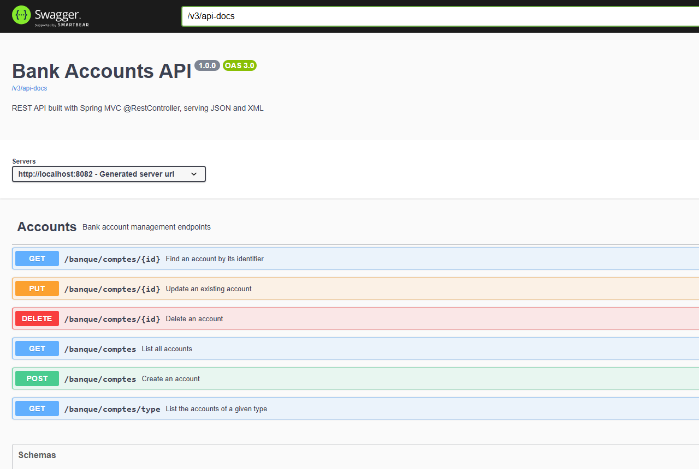

# J2E-TP8 — Spring @RestController

TP 8 du cours *Architecture Microservices* — API REST de comptes bancaires avec **Spring MVC**, sortie **JSON et XML**, documentée avec **Swagger**.



## Stack

`Java 17` · `Spring Boot 3.2` · `Spring MVC` · `Jackson XML` · `H2` · `springdoc-openapi` · `Lombok`

## Lancer

```bash
mvn spring-boot:run   # http://localhost:8082
mvn test
```

- Swagger UI : <http://localhost:8082/swagger-ui.html>
- Console H2 : <http://localhost:8082/h2-console>

## Endpoints

| Méthode | URL | Résultat |
|---|---|---|
| GET | `/banque/comptes` | 200 (JSON ou XML) |
| GET | `/banque/comptes/{id}` | 200 / 404 |
| POST | `/banque/comptes` | 201 + header `Location` |
| PUT | `/banque/comptes/{id}` | 200 / 404 |
| DELETE | `/banque/comptes/{id}` | 200 / 404 |
| GET | `/banque/comptes/type?type=SAVINGS` | liste filtrée |

```bash
curl -X GET "http://localhost:8082/banque/comptes" -H "Accept: application/xml"

curl -X POST "http://localhost:8082/banque/comptes" \
  -H "Content-Type: application/json" \
  -d '{"balance":1500.0,"creationDate":"2024-11-01","type":"CURRENT"}'
```

## Architecture

```
controllers/ AccountController      @RestController, @Tag/@Operation
entities/    Account, AccountType   @Entity + @JacksonXmlRootElement
repositories/AccountRepository
config/      OpenApiConfig, CorsConfig, DataInitializer
```

JSON et XML sont produits par le même endpoint ; Spring choisit le convertisseur
(`MappingJackson2HttpMessageConverter` / `MappingJackson2XmlHttpMessageConverter`)
selon l'en-tête `Accept`.

**Tests : 8/8** — `AccountControllerTest` vérifie JSON, XML, 201 + `Location`, 404 et le filtre par type.

Lié au TP 9 : `CorsConfig` autorise `http://localhost:*` pour le client React.

Auteur : [zAK4-7](https://github.com/zAK4-7)
